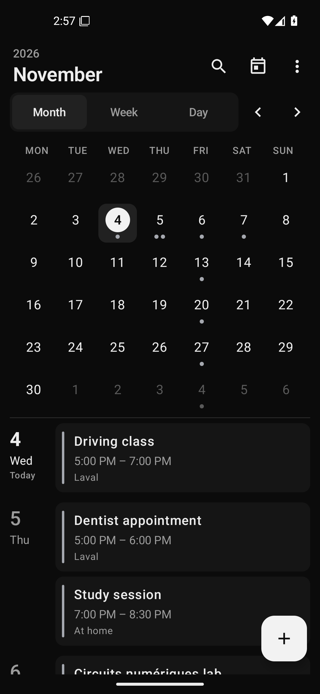
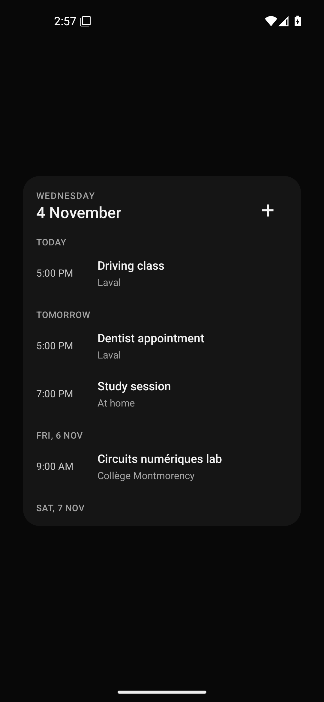

# Sunlith

A clean calendar app. Your plans, widget, and reminders, together on your phone.

**Early alpha · Android 8.0+ · No ads · No analytics**

<p>
  
  
</p>

## What it does

- AI control through the [MCP companion](docs/AI-INTEGRATION.md), using a shared Google calendar and your computer’s assistant. AI setup is recommended at first launch; you can also continue without it.
- Month, week, and day agendas; search; calendar filters; quick navigation to today.
- Create, edit, and delete personal events, with dates, times, notes, location, all-day dates, repeat presets, and reminders.
- A resizable, scrollable agenda widget with adjustable background opacity and shortcuts to events and creation.
- Event notifications with snooze and dismiss, plus an option to let your existing calendar app handle reminders.
- Read the calendars already on your phone, including calendars shown in DigiCal. Your account's existing sync adapter handles syncing.
- Import and export `.ics` files through Android's document picker. No broad file access is needed.

The Android app has **no Internet permission**. It uses Android's shared calendar provider rather than keeping a separate event database. Calendar permission gives it access to your device calendars; the calendar filters only change what Sunlith displays.

## Install the alpha

[Download Sunlith v0.0.1-alpha.1](https://github.com/SunSinD/Sunlith/releases/download/v0.0.1-alpha.1/Sunlith-v0.0.1-alpha.1.apk) · [Release notes](https://github.com/SunSinD/Sunlith/releases/tag/v0.0.1-alpha.1)

Install the APK on your phone, allowing installation from that source when Android asks. This is an early test build, marked as a GitHub prerelease. Back up important calendars before testing imports or changes.

The first alpha is debug-signed. Locally built, CI-built, and release-asset APKs can have different signing keys; Android cannot install one over a differently signed version. Keep using the published release APKs during testing. Production signing is planned before a stable release.

On first launch, choose **Set up AI** for the recommended setup, or **Continue without AI**. Then grant calendar access and select your calendars. Use a shared Google calendar for AI control; a phone-only calendar also works for manual use. Add the widget through your launcher's widget picker under **Sunlith**.

## Moving from DigiCal

Start by selecting the same account and calendars. If those events are in Android's shared calendar provider, they should appear without copying or importing anything.

Local calendars may belong to DigiCal or another account provider. **Keep DigiCal installed until you have exported a backup and checked your events in Sunlith.** Selecting a phone-only calendar does not upload it to Google. See the [migration guide](docs/MIGRATION.md) before copying local events into a synced calendar.

## Control from your PC or T3 Code

[Download the desktop companion](https://github.com/SunSinD/Sunlith/releases/download/v0.0.1-alpha.1/Sunlith-companion-v0.0.1-alpha.1.zip). This is one portable source package for Windows, macOS, and Linux with Node.js 22+, rather than a separate desktop calendar or installer. Extract it, read `START-HERE.md`, and follow the setup guide.

```text
Ask your assistant → Sunlith MCP on your computer → Google Calendar
                                                   ↓ Android account sync
                                              Sunlith + widget
```

The companion is a standard local stdio MCP server. The app’s setup screen covers T3 Code’s Codex, Claude, Cursor, Grok, OpenCode, Antigravity, Muse Code, and Pi choices, with provider-specific support and limits in the guide. T3 Code's mobile app can control a configured provider running on your computer. Individual client integrations have not all been tested end to end.

AI setup is the recommended way to use Sunlith. You can still use the full calendar without it. Sunlith requires no AI subscription of its own; your assistant may have its own account or costs. Your computer is needed while its assistant carries out a request, not afterward for phone reminders. See [AI integration](docs/AI-INTEGRATION.md).

A local browser setup wizard is a possible follow-up after phone testing. This alpha uses the existing authorization command and client configuration guides. It does not include a hosted setup service or native desktop installers.

## Build

Install JDK 17 and Android SDK platform 36 / build tools 36.0.0. Set `ANDROID_HOME` or create an untracked `local.properties` with your SDK path.

```powershell
.\gradlew.bat :app:testDebugUnitTest :app:lintDebug :app:assembleDebug
```

macOS/Linux:

```sh
./gradlew :app:testDebugUnitTest :app:lintDebug :app:assembleDebug
```

APK output: `app/build/outputs/apk/debug/app-debug.apk`.

MCP checks, with Node.js 22+:

```sh
cd integrations/mcp
npm ci
npm run check
npm test
```

See [testing](docs/TESTING.md), [architecture](docs/ARCHITECTURE.md), [calendar research](docs/RESEARCH-CALENDAR.md), and [versioning](docs/VERSIONING.md).

## Alpha limits

- Real Google sign-in, your account's sync behavior, Samsung battery restrictions, and reminder delivery on your phone need testing on your device.
- Sync and background widget updates follow Android's scheduling rules; they are not guaranteed to be instant.
- Editing/deleting meetings with guests and complex recurring exceptions is intentionally blocked to avoid unintended invitation emails or recurrence changes. Use your existing calendar app for those events.
- Import supports personal events and basic recurrence. Unsupported exception-heavy series are reported and skipped. An export is a useful backup, but is not a promise of lossless migration for every calendar format.
- Some detailed import/provider diagnostics are English in both interface languages.
- The MCP adapter currently supports Google Calendar. Other calendars supplied to Android can appear in the app, but this companion cannot yet control Outlook, CalDAV, or phone-only calendars.
- Weather, booking pages, social features, task services, and in-app AI are outside the current scope.

## License

Apache-2.0. See [LICENSE](LICENSE) and [third-party notices](docs/THIRD-PARTY.md).
