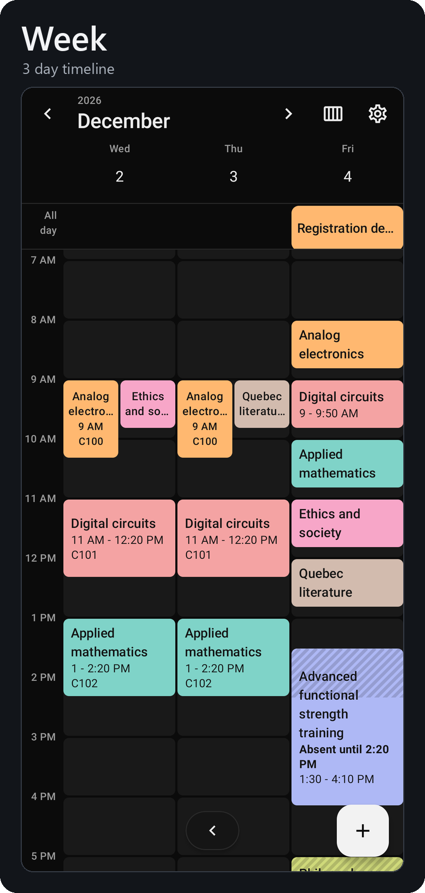
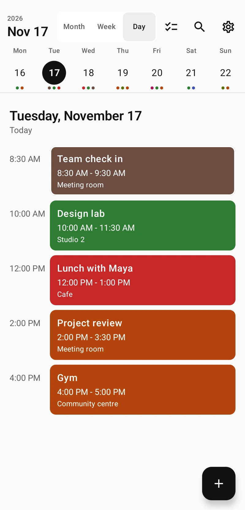

<p align="center">
  <picture>
    <source media="(prefers-color-scheme: dark)" srcset="docs/media/sunlith-logo-dark.svg" />
    
  </picture>
</p>

<h1 align="center">Sunlith</h1>

<p align="center">An Android calendar you can update with a prompt from your computer.</p>

<p align="center">
  <a href="https://github.com/SunSinD/Sunlith/releases/latest"><strong>Download for Android</strong></a><br />
  Android 8.0 or newer. No ads or analytics.
</p>

<p align="center">
  <picture></picture>
</p>

<p align="center">
  <picture></picture>
  <picture></picture>
  <picture></picture>
</p>

<details>
<summary>Light mode screenshots</summary>

<p align="center">
  <picture></picture>
  <picture></picture>
  <picture></picture>
</p>

</details>

## Your calendar

- **Month, Week and Day.** Hold a tab to change its layout. Scroll through Week in 3, 5 or 7 day views and pinch to zoom.
- **Events and tasks.** Add reminders or repeating events, search your calendar, and mark events as tasks. See what’s coming up in the agenda widget.
- **Appearance.** Choose light, dark or wallpaper colors, adjust the timeline tint, and use Sunlith in English or French.

<details>
<summary>Preview the app icons</summary>

| Light | Dark |
| :---: | :---: |
| <picture></picture> | <picture></picture> |

Pick one in Settings > Appearance > App icon.

</details>

## Connect your computer

Set this up once, then ask your assistant to add, move or remove events on your phone. You can type a request or attach a screenshot if your assistant supports images. A direct connection works without a Google account.

You'll need an assistant installed on your computer, such as the [Codex CLI](https://developers.openai.com/codex/cli/) or [Claude Code](https://code.claude.com/docs/en/setup).

### 1. Install the companion

1. Install [Node.js](https://nodejs.org/) version 22 or newer on your computer.
2. Download the **Sunlith companion ZIP** from the [latest release](https://github.com/SunSinD/Sunlith/releases/latest) and extract it. Open the extracted folders until you see `START-HERE.md`. From there, open `integrations/mcp`. You should see `package.json`.
3. Open a terminal in that folder. On Windows, click the File Explorer address bar, type `cmd` and press Enter. On macOS or Linux, open Terminal, type `cd` followed by a space, then drag the `mcp` folder into the window or paste its full path in quotes. Press Enter. Run this and wait for it to finish.

   ```sh
   npm ci
   ```

### 2. Pair your phone

1. Put your phone and computer on the same home WiFi. If you use Tailscale, turn it on on both devices with the same account instead.
2. In Sunlith, open **Settings > Computer connection**. Check the calendar you want your assistant to use, then tap **Connect computer**.
3. Send the file privately to your computer using the share menu. If you use Tailscale, select it and pick your computer. Quick Share is another option if it's installed on your Windows computer.
4. Look for `sunlith-pairing.json` in Downloads after the transfer. Move it to your user folder, outside the extracted companion. On Windows, type `%USERPROFILE%` into the File Explorer address bar to open your user folder. On macOS or Linux, use your home folder. Keep the original filename unless the transfer added a number like `(1)`. Treat the file like a password.

### 3. Add Sunlith to your assistant

Use the terminal you opened in step 1. Pick the command for your assistant. It looks for the pairing file in the user folder from step 2.

<details>
<summary>Windows commands</summary>

**Codex**

```bat
codex mcp add sunlith --env "SUNLITH_DEVICE_CONFIG=%USERPROFILE%\sunlith-pairing.json" -- node "%CD%\src\index.js"
```

**Claude Code**

```bat
claude mcp add --scope user --env "SUNLITH_DEVICE_CONFIG=%USERPROFILE%\sunlith-pairing.json" --transport stdio sunlith -- node "%CD%\src\index.js"
```

</details>

<details>
<summary>macOS and Linux commands</summary>

If you're using Tailscale on Linux, [receive the file](https://tailscale.com/docs/features/taildrop) before continuing.

First, make the pairing file readable only by you.

```sh
chmod 600 "$HOME/sunlith-pairing.json"
```

**Codex**

```sh
codex mcp add sunlith --env "SUNLITH_DEVICE_CONFIG=$HOME/sunlith-pairing.json" -- node "$PWD/src/index.js"
```

**Claude Code**

```sh
claude mcp add --scope user --env "SUNLITH_DEVICE_CONFIG=$HOME/sunlith-pairing.json" --transport stdio sunlith -- node "$PWD/src/index.js"
```

</details>

Using Cursor or another assistant that supports local MCP tools? [See the other setup options](docs/AI-INTEGRATION.md#direct-phone-connection).

### 4. Try it

1. On your phone, tap **Start connection**. Allow notifications if Android asks. When you see **Connection on**, tap **Open calendar**.
2. Start a new session in your assistant and ask **“Which calendars can you see in Sunlith?”**
3. Once it lists your calendar, try **“Add dinner at The Keg tomorrow at 6 PM for one hour.”** Open tomorrow in Sunlith to see the event.

Next time, make sure both devices are on the same network and the phone says **Connection on**. Use **Stop connection** to pause access, **Unpair computer** to remove it, or **Activity history** to see what changed.

<details>
<summary>If it does not connect</summary>

- **The assistant cannot find Sunlith.** Open a new session after setup. Check the registration with `codex mcp list` or `claude mcp list`.
- **It cannot read the pairing file.** Check the filename and location from step 2. On Windows, use **View > Show > File name extensions** to check that the name ends in `.json` only once. On macOS and Linux, run the `chmod` command from step 3.
- **It cannot reach your phone.** Check the network and tap **Start connection** if it is off. School or guest WiFi may block the connection. If your phone's WiFi address changed, tap **Unpair computer** and repeat step 2 to replace the old file.
- **It cannot add events.** Check that the calendar is shared and that you can add an event to it on your phone. If it can add events but you cannot see them, check **Settings > Calendars** in Sunlith.

</details>

## School schedules

I built this for Col.NET at Collège Montmorency, my own college. It brings classes, schedule changes and college notices into Sunlith. Find it in Settings > Calendars > School schedule.

Other Col.NET schools can be set up manually. If you’d like me to add support for your school, [open an issue and let me know](https://github.com/SunSinD/Sunlith/issues/new).

## Build and checks

```sh
./gradlew :app:testDebugUnitTest :app:lintDebug :app:assembleDebug
```

See [testing](docs/TESTING.md), [architecture](docs/ARCHITECTURE.md), [calendar imports](docs/MIGRATION.md) and the [changelog](CHANGELOG.md). For updates in the app, open Settings > About > Check for updates.
