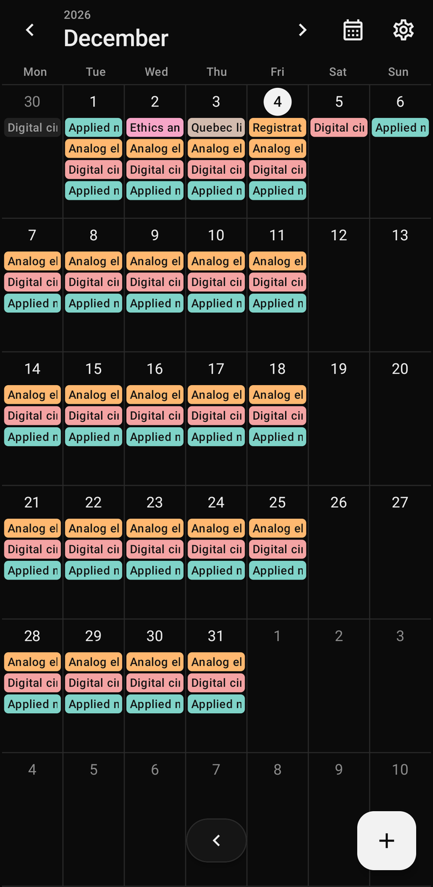
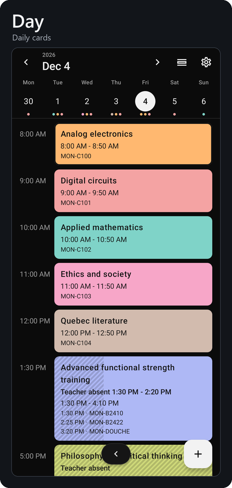
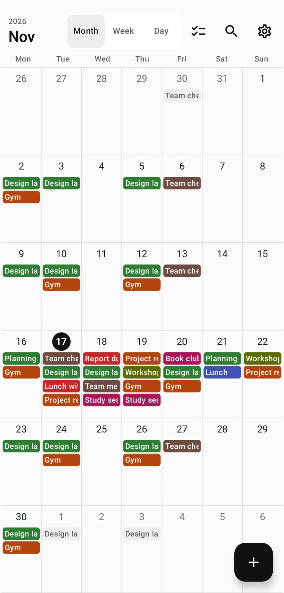
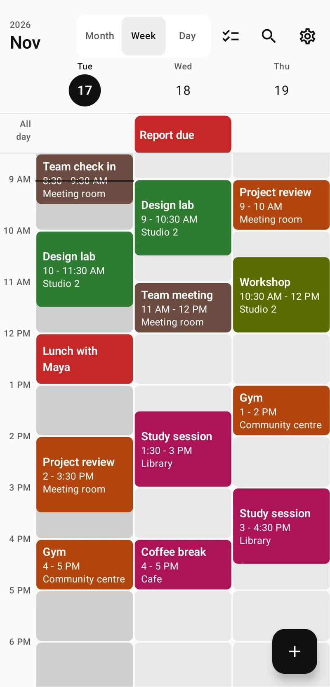

<p align="center">
  <picture>
    <source media="(prefers-color-scheme: dark)" srcset="docs/media/sunlith-logo-dark.svg" />
    
  </picture>
</p>

<h1 align="center">Sunlith</h1>

<p align="center">An Android calendar you can update with a prompt from your computer.</p>

<p align="center">
  <a href="https://github.com/SunSinD/Sunlith/releases/latest"><strong>Download for Android</strong></a><br />
  Android 8.0 or newer. No ads or analytics.
</p>

<p align="center">
  <picture></picture>
</p>

<p align="center">
  <picture></picture>
  <picture></picture>
  <picture></picture>
</p>

<details>
<summary>Light mode screenshots</summary>

<p align="center">
  <picture></picture>
  <picture></picture>
  <picture></picture>
</p>

</details>

## Your calendar

- **Month, Week and Day.** Hold a tab to change its layout. Scroll through Week in 3, 5 or 7 day views and pinch to zoom.
- **Events and tasks.** Add reminders or repeating events, search your calendar, and mark events as tasks. See what’s coming up in the agenda widget.
- **Appearance.** Choose light, dark or wallpaper colors, adjust the timeline tint, and use Sunlith in English or French.

<details>
<summary>Preview the app icons</summary>

| Light | Dark |
| :---: | :---: |
| <picture></picture> | <picture></picture> |

Pick one in Settings > Appearance > App icon.

</details>

## Connect your computer

Ask your assistant to add, move or remove events in the calendars already on your phone. Type a request or attach a screenshot if your assistant supports images.

In Settings > Computer connection, pick which calendars to share and pair over WiFi or Tailscale. You can stop access from your phone and review changes in Activity history. A direct connection works without a Google account.

The companion works on Windows, macOS and Linux. [Connection setup](docs/AI-INTEGRATION.md#direct-phone-connection)

## School schedules

I built this for Col.NET at Collège Montmorency, my own college. It brings classes, schedule changes and college notices into Sunlith. Find it in Settings > Calendars > School schedule.

Other Col.NET schools can be set up manually. If you’d like me to add support for your school, [open an issue and let me know](https://github.com/SunSinD/Sunlith/issues/new).

## Build and checks

```sh
./gradlew :app:testDebugUnitTest :app:lintDebug :app:assembleDebug
```

See [testing](docs/TESTING.md), [architecture](docs/ARCHITECTURE.md), [calendar imports](docs/MIGRATION.md) and the [changelog](CHANGELOG.md). For updates in the app, open Settings > About > Check for updates.
